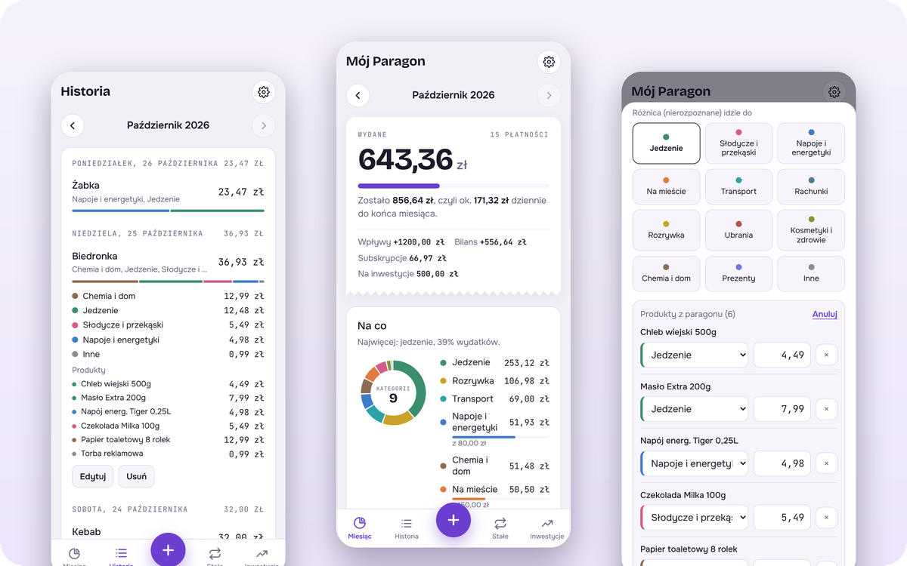
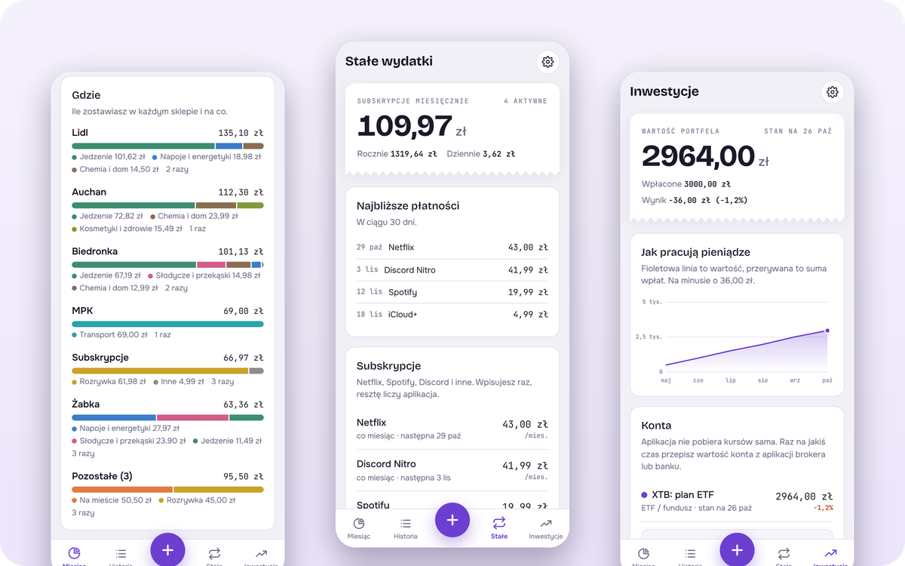

<picture>
  <source media="(prefers-color-scheme: dark)" srcset="docs/banner-dark.png">
  
</picture>

# Mój Paragon

Prosta aplikacja na telefon do pilnowania wydatków. Pokazuje nie tylko ile wydajesz, ale **na co i gdzie**, czyli ile w Żabce poszło na energetyki, a ile na jedzenie.

**[Otwórz aplikację →](https://kamsky0.github.io/paragon/)**

## Co potrafi

- **Szybkie dodawanie**: kwota, sklep i kategoria w kilka sekund, a najczęstsze sklepy i rzeczy są pod jednym dotknięciem.
- **Dzielenie paragonu**: jedna płatność kartą może trafić do kilku kategorii.
- **Skan paragonu**: aplikacja odczytuje produkty ze zdjęcia, sama je sortuje i uczy się z poprawek.
- **Budżet**: miesięczny limit, limity na kategorie i informacja, ile możesz wydać dziennie.
- **Wykresy**: podział na kategorie i sklepy, tempo wydawania i porównanie miesięcy.
- **Stałe wydatki**: Netflix, Spotify, Discord i inne subskrypcje same dopisują się w dniu płatności.
- **Wpływy i inwestycje**: stypendium, wypłata, bilans miesiąca i wartość portfela w czasie.
- **Jasny i ciemny motyw**: dopasowuje się do ustawień telefonu.

<picture>
  <source media="(prefers-color-scheme: dark)" srcset="docs/funkcje-dark.png">
  
</picture>

## Prywatność

Wszystkie dane zostają w telefonie. Aplikacja nie ma serwera ani konta i niczego nie wysyła. Skan paragonu też działa w telefonie: przy pierwszym użyciu pobiera tylko silnik rozpoznawania tekstu.

## Instalacja

1. Otwórz [kamsky0.github.io/paragon](https://kamsky0.github.io/paragon/) w Chrome na Androidzie.
2. Wybierz **⋮ → Zainstaluj aplikację**.

Na iPhonie: Safari → **Udostępnij → Do ekranu początkowego**.

## Kopia zapasowa

Ponieważ dane są tylko w telefonie, raz w miesiącu zrób kopię w **Ustawieniach → Zrób kopię zapasową** i zapisz plik np. na Dysku Google. Na nowym telefonie wczytasz ją przyciskiem **Wczytaj kopię**.

## Jak to jest zrobione

Jeden plik HTML bez frameworków i bez serwera. Działa jako aplikacja PWA, także offline. Hosting: GitHub Pages.
